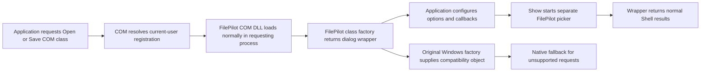

# Modern dialog COM replacement versus system DLL replacement

Investigated 2026-10-10 using read-only registry, DLL metadata/exports/ACLs,
existing FilePilot adapter source, and primary Windows documentation. No COM
registrations, system files, security policies, or running applications were
changed. No tests or runtime validations were written or run. The deployed API
injection agent remains the active interception mode.

## Findings on this machine

| Item | Observed value |
| --- | --- |
| Open class | `{DC1C5A9C-E88A-4DDE-A5A1-60F82A20AEF7}` |
| Save class | `{C0B4E2F3-BA21-4773-8DBA-335EC946EB8B}` |
| Machine registration, both registry views | `C:\WINDOWS\System32\comdlg32.dll` |
| Both threading models | `Apartment` |
| Current-user registrations, both views | Absent |
| KnownDLL registration | `COMDLG32 = COMDLG32.dll` |
| x64 DLL version | `10.0.26100.8117` |
| x86 DLL version | `10.0.26100.9278` |
| Both DLL owners | `NT SERVICE\TrustedInstaller` |
| Users/Administrators/SYSTEM access in inspected ACLs | Read and execute; TrustedInstaller has full control |

The physical x64 file is in System32; the x86 file is in SysWOW64. The same
System32 registry string in a 32-bit view should not be interpreted as loading
an x64 DLL into an x86 process: WOW64 redirects ordinary system-path access.
[File-system redirection](https://learn.microsoft.com/en-us/windows/win32/winprog64/file-system-redirector).

Both files export `DllGetClassObject`, `DllCanUnloadNow`, legacy Open/Save W/A,
and `CommDlgExtendedError`. The x64 export table has 30 function entries and
includes color, font, find/replace, printing, and page-setup interfaces. A full
replacement therefore affects considerably more than file selection.

## COM replacement design

The proposed installer adds overrides for only the two dialog CLSIDs under the
current user's `Software\Classes\CLSID`, in both architecture views. Each
`InprocServer32` points to an immutable package DLL of the matching architecture,
with `ThreadingModel=Apartment`. Ordinary COM registry lookup merges current-user
and machine class information. This is an override of Windows classes, not a
documented FilePilot provider extension point. Some activation/security contexts
can ignore per-user configuration. [Registry merge behavior](https://learn.microsoft.com/en-us/windows/win32/sysinfo/merged-view-of-hkey-classes-root),
[server registration](https://learn.microsoft.com/en-us/windows/win32/com/inprocserver32),
[WOW64 registry views](https://learn.microsoft.com/en-us/windows/win32/winprog64/registry-redirector).

This uses normal COM loading. It does not require a resident attachment host,
remote memory writes, remote threads, API detours, or a specialized application
launcher. It still places custom DLL code inside the process which requests a
dialog. Replacing the registration is centralized; execution remains per process.

### Factory and wrapper responsibilities

Build dedicated `FPilotDialogCom64.dll` and `FPilotDialogCom32.dll` payloads, rather
than registering the current injection DLL. Its current export table contains
installation/agent/test entry points and no COM-server factory exports.

`DllGetClassObject` recognizes only Open and Save and supplies an `IClassFactory`.
`CreateInstance` constructs the appropriate wrapper and obeys COM interface and
aggregation rules. `DllCanUnloadNow` must account for factories, dialog objects,
server locks, and active picker/callback work. Keep initialization out of DllMain.
[Factory export](https://learn.microsoft.com/en-us/windows/win32/api/combaseapi/nf-combaseapi-dllgetclassobject),
[instance creation](https://learn.microsoft.com/en-us/windows/win32/api/unknwn/nf-unknwn-iclassfactory-createinstance),
[unloading](https://learn.microsoft.com/en-us/windows/win32/api/combaseapi/nf-combaseapi-dllcanunloadnow).

Extract the modern `Dialog` wrapper from `adapter.cpp` into shared implementation
code. Reuse its options, event sinks, cancellation, Shell results, and picker IPC.
Keep the dedicated server independent of MinHook, remote attachment, child delivery,
and mandatory injection-agent policy. Resolve its picker from its own immutable
package location. Policy can be read locally; excluded/paused requests delegate
to the original native implementation. The current wrapper already avoids native
`Show` for supported FilePilot requests and mirrors configuration into its native
compatibility object.

### Native fallback without recursion

Once a CLSID is overridden, ordinary `CoCreateInstance` for that CLSID would
select our server again. Creating the compatibility object that way would recurse.

Instead, load the original Windows `comdlg32.dll` from the correct system path,
resolve its observed `DllGetClassObject` export, obtain the original Open/Save
factory directly, and use its `CreateInstance`. Hold the module for as long as
any factory or native dialog interface remains alive. The original Windows
object can then supply native configuration, unsupported interfaces/aggregation,
and fallback display. This design follows the factory contract and the exports
observed here; its runtime behavior has not been exercised.

Do not temporarily remove registration overrides to obtain fallback objects:
that would race other processes. Do not take the native DLL path from the merged
registration, because it now names our replacement. Keep fallback bound to the
original architecture-appropriate Windows implementation.

### Why a separate COM EXE does not remove the DLL

The common dialog activation contract normally specifies `CLSCTX_INPROC_SERVER`.
That permits an in-process DLL, not a substitute EXE merely registered under
`LocalServer32`. The FilePilot UI can run separately, but a compatible in-process
bridge is still necessary for these callers. [Dialog activation](https://learn.microsoft.com/en-us/windows/win32/shell/common-file-dialog),
[activation contexts](https://learn.microsoft.com/en-us/windows/win32/api/wtypesbase/ne-wtypesbase-clsctx).

### Deployment and coverage

Preserve the complete prior current-user class subtrees in each registry view
before changing them, including the fact they were absent. Publish payloads
before registry changes. Rollback should restore the saved state only when the
installed values still belong to this package, preserving subsequent changes by
another installer. Retain older payloads while applications may reference them.
Existing objects/cached factories do not turn into our wrapper retrospectively.

The injected API agent and COM replacement should be mutually exclusive, to
avoid wrapping our own replacement twice. Stop attachment mode when installing
the COM route. A locally configured exclusion allows native delegation, but does
not prevent the COM bridge itself loading when an application requests the class.

Coverage is future registry-based activation of these modern classes where the
override is honored. Legacy exported functions, private factories, registration-
free activation, existing objects, custom pickers, and separate picker systems
are not universally covered. Binary-signature restrictions can reject our DLL.
[Signature policy](https://learn.microsoft.com/en-us/windows/win32/api/winnt/ns-winnt-process_mitigation_binary_signature_policy).
Avoiding remote injection does not establish that security products will accept
an override of Windows COM classes.

## Replacing the native system DLL

There are three distinct proposals:

| Proposal | Scope and limitation |
| --- | --- |
| Replace/patch the Windows comdlg32 files | Broad modern and legacy interception, but changes protected OS components and affects other dialog APIs |
| Put a proxy comdlg32 next to an application | Normally defeated by KnownDLL precedence on this machine; explicit redirection is a separate, application-specific mechanism |
| Register a separately named COM proxy | The COM approach above; leaves the original Windows DLL available for direct native fallback |

Under normal DLL search order, KnownDLL resolution precedes the application
directory. The observed KnownDLL entry therefore matters: merely dropping a
proxy beside an EXE is not a universal replacement. Explicit DLL/manifest
redirection has its own rules and cannot be assumed to cover all applications.
[Loader ordering](https://learn.microsoft.com/en-us/windows/win32/dlls/dynamic-link-library-search-order),
[explicit redirection](https://learn.microsoft.com/en-us/windows/win32/dlls/dynamic-link-library-redirection).

A system-file proxy would need to preserve names, ordinals, calling conventions,
COM factories, resources, callbacks, and every unrelated exported operation.
Legacy Open/Save results must retain buffer sizing, encoding, flags, multiselection,
extended errors, and application hooks/templates. Native fallback requires a
separately accessible original implementation without loader recursion; copying
an old native DLL is not a servicing plan. Internal dependencies and assumptions
about module identity would require additional binary analysis.

The inspected ACLs do not allow ordinary administrative writes to either file.
Windows Resource Protection controls replacement of protected resources;
Windows servicing owns their lifecycle. A patched binary no longer retains the
original signature's assurance, and policies requiring Microsoft-signed images
can reject replacement code. Already loaded modules also complicate a live swap.
[Resource protection](https://learn.microsoft.com/en-us/windows/win32/wfp/about-windows-file-protection),
[supported replacement mechanisms](https://learn.microsoft.com/en-us/windows/win32/wfp/supported-file-replacement-mechanisms),
[signature restrictions](https://learn.microsoft.com/en-us/windows/win32/api/winnt/ns-winnt-process_mitigation_binary_signature_policy).

This route broadens deployment but still executes custom code inside callers.
It does not remove in-process crash risk, guarantee acceptance by security
software, or cover application-drawn/other picker implementations. It is an
OS-modification research branch, not the recommended deployment for this machine.
No ownership changes, protection changes, file replacement, or such prototype
was performed.

## Recommended next implementation

Implementation update, 2026-10-10: the standalone x64/x86 COM bridge is now
implemented, compiled, packaged and registered for the current user. The
shared modern-dialog wrapper lives in `patcher/dialogs/modern_dialog.cpp`;
`com_server.cpp` supplies the COM factory and direct system-DLL factory access.
The package uses `ComRuntime-1-*` payloads and a separate `com-runtime.txt`.
`install-com.ps1` preserves original registrations with raw registry-tree
copies, records ownership and restores only owned server subtrees. Its shutdown
path enumerates the controller's process-thread windows, rather than relying
on a desktop-wide window lookup. The previous interceptor was stopped normally
and its matching startup entry removed with a backup. This is now the active
mode; Windows DLLs remain untouched. Applications must be restarted to release
old adapters and cached factories. No application was terminated, and no tests
or validations were written or run. See
[COM-README.md](../patcher/dialogs/COM-README.md) for install, disable and recovery
commands. The original recommendation below describes the design leading to
this implementation.

Prepare the standalone x64/x86 COM server using shared modern wrapper code,
direct native-factory fallback, explicit local policy, immutable packaging,
and reversible per-user registration tooling. Compile the inactive package
before any registration change. This is the useful next step toward normal COM
loading instead of the current remote-injection mechanism. Legacy coverage can
remain an explicit separate decision.

System DLL replacement should remain a comparative research item. Static
exports and registrations already identify the immediate integration points;
no additional Windows binaries need to be supplied for the COM-server design.
Deeper system-proxy compatibility research would use copies of both exact native
DLL versions and their dependencies, not modifications to the installed files.
