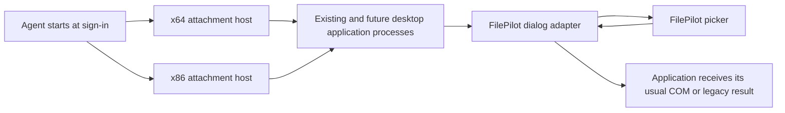

# FilePilot dialogs without an application launcher

Investigated 2026-10-09. Investigation used existing source, read-only Windows
COM registration, and primary documentation. No tests or validations were written
or run, and no applications were injected during this investigation.

## Implementation delivered

The user subsequently chose API interception before native display. The active
deployment uses the resident API agent and its existing COM/legacy adapters;
the external watcher is stopped. `FPilotDialogAgent.exe --install` now gracefully
switches this package from external mode to API mode. See the
[suppression research and implementation](filepilot-native-dialog-suppression-research.md).

The user subsequently requested the external alternative. It is implemented as
`FPilotDialogExternal.exe`; see [external deployment and scope](../patcher/dialogs/EXTERNAL-README.md).
It uses out-of-context window events, UI Automation, standard cross-process
control messages, and isolated workers. It does not inject into applications or
replace COM registrations. Native dialogs remain responsible for final acceptance
and application result delivery. It is a universal watcher for recognizable
standard dialog windows, not interception of every picker API or custom UI.
The injection agent below remains available as an alternative mode.

`patcher/dialogs/build-agent.ps1` now builds/packages the independent resident-agent
baseline. See [usage and current limits](../patcher/dialogs/AGENT-README.md).
The implementation includes current-user sign-in registration, tray enable/pause,
x86/x64 hosts, attachment of existing GUI processes, desktop-message bootstrap
hooks, two-second reconciliation, a per-process installation handshake, exclusions,
and attachment status/error reporting. Per-process diagnostics show the last
intercepted request's routing/fallback category without retaining selected paths.
It adds ole32/combase and supported
CoCreateInstanceEx activation coverage to the adapter. Runtime payloads are copied
into immutable versioned directories selected by `agent-runtime.txt`.
The subsequent [Brave download investigation](filepilot-brave-save-investigation.md)
adds activation-stage and specific fallback diagnostics, foreground/visible-process
attachment priority, and versioned hosts/bootstrap binaries. A follow-up observation
confirmed that Brave creates its native dialog in a fresh UtilWin utility process
before asynchronous attachment. The package now implements scoped parent delivery
through CreateProcessW/CreateProcessAsUserW for matching unsandboxed UtilWin children,
including loader initialization, serialized attachment and pre-entry hook installation.
Runtime behavior of this addition remains unverified under the user's no-tests rule.
Hook installation afterward does not convert an already created native dialog.

The installer enables deployment when explicitly invoked with `--install`. Both
architectures compiled. Runtime behavior remains unverified because the user
instructed that tests and validations must not be written or run. The broader
control/property/WinRT compatibility work and general parent-process delivery beyond
the scoped UtilWin component remain future extensions. Current discovery does not guarantee interception
of the first dialog before attachment, and an installation handshake only reports
hook installation, not full dialog compatibility.

## Recommendation

Add a resident, per-user **FilePilot Dialog Agent** that starts at sign-in and
automatically loads the existing adapter into ordinary desktop applications.
Attach to applications already running when the agent starts, then cover future
applications. Users continue opening applications from their normal shortcuts.
Reuse `FPilotPicker.exe`, its native footer, and the COM/legacy result adapters.

The attainable coverage is standard Windows desktop Open/Save dialogs in processes
that allow the adapter to load, after attachment completes. There is no single
supported Windows setting that redirects every picker technology to FilePilot.
An application can draw its own dialog, use a separate picker broker, or prohibit
third-party DLLs. Those cases require their own integration or native fallback.
This is an architectural conclusion from the distinct API and loading contracts,
not a claim that every Windows implementation has been reverse engineered.

The existing browser process is a target for attachment, but Chrome's dialog
factory can launch a separate UtilWin service process for the picker. Attaching
the browser alone does not cover that process's first dialog. The confirmed Brave
case uses the newly implemented scoped parent delivery into the utility child; opening another
browser executable does not supply it. A dialog already open, or a native dialog
object constructed before attachment, is not retroactively converted by the
current creation hooks.

## Existing implementation and missing work

`patcher/dialogs/adapter.cpp` already exports `FilePilotInstall`, accepts an absolute
picker path, and installs process-local detours for `CoCreateInstance`,
`CoGetClassObject`, legacy Open/Save W/A functions, and `CommDlgExtendedError`.
Its initialization is idempotent. `DllMain` does minimal work; loading the DLL alone
does not enable replacement. The current launcher loads the DLL and explicitly
calls its installer in one newly created process.

`client.cpp` already starts the picker as a child of the requesting application
using restricted handle inheritance. It preserves the application's execution
context and runs modal callbacks in the requesting thread. Keep this direct
application-to-picker path initially. The agent should distribute policy and
manage attachment; it need not relay every file selection or launch all pickers
under its own token.

Delivery alone does not make the current adapter support all dialogs. It deliberately
retains native UI for customization calls, Save metadata, virtual folders,
unsupported options, and legacy templates/hooks. Both delivery and those feature
contracts must be expanded.

## Delivery options

| Approach | What it achieves | Decision |
| --- | --- | --- |
| Resident agent with x86/x64 attachment and desktop hooks | Existing and normally launched desktop applications; reuses the adapter | Recommended independent package |
| Windhawk mod using its resident injection engine | Similar automatic delivery, including an established early process-start mechanism | Viable implementation alternative if a Windhawk dependency is acceptable |
| Per-user COM registration for the two dialog CLSIDs | Future registry-based modern COM activations | Optional alternative; incomplete coverage and more difficult fallback |
| AppInit DLL registration | Legacy process-wide DLL delivery | Reject: disabled with Secure Boot and discouraged by Microsoft |
| Detect a visible dialog and automate its controls | Recognizable native dialogs after they appear; native processing retains result delivery | Implemented at the user's request as external mode; configuration fidelity and custom/brokered coverage remain limited |
| Replace Windows DLLs or add a kernel driver | Much larger Windows integration project | Unnecessary for ordinary desktop coverage; still cannot supply arbitrary application picker contracts |

Microsoft documents the Secure Boot restriction for
[AppInit DLLs](https://learn.microsoft.com/en-us/windows/win32/dlls/secure-boot-and-appinit-dlls).
Its documented [Windows hook API](https://learn.microsoft.com/en-us/windows/win32/api/winuser/nf-winuser-setwindowshookexw)
provides in-process hook delivery, with matching process/DLL architecture and
desktop/security restrictions. These are loading mechanisms, not a file-dialog
provider registration API.

## Resident agent architecture

Proposed package additions are `FPilotDialogAgent.exe`, `FPilotDialogHost64.exe`,
`FPilotDialogHost32.exe`, and a small hook bootstrap DLL for each architecture.
The agent provides enable/pause, start-at-sign-in, exclusions, and a process status
list. Separate discovery, attachment, and dialog-handling status: seeing an
application is not evidence that its adapter installed successfully.

### Applications already running

On startup, enumerate eligible processes in the current user's interactive session,
including GUI processes without a currently visible top-level window. Resolve
their architecture and dispatch to the matching attachment host. Track process
creation time as well as PID so PID reuse cannot retain a stale attached status.

For a running target, load the matching adapter and invoke `FilePilotInstall`
outside loader lock. Reuse the launcher's address resolution and configuration
transfer concepts, but extract them into an attachment module. Do not run its
pre-entry `initializeLoader` routine in running targets, and do not terminate an
existing application when attachment fails. A timed-out initialization operation
must retain any memory/resources that its thread may still access.

The adapter handshake returns its build/protocol version, installed hook set,
policy generation, and specific failure information. Successfully loading a DLL
is not equivalent to enabling dialogs. Match full module identity/path rather than
accepting any module with the same basename.

### Future applications and timing

Keep x86 and x64 hook hosts alive with message loops. A minimal `WH_GETMESSAGE`
bootstrap can request one-time installation in a matching target process. It must
detect callbacks occurring in the host rather than the target, chain with
`CallNextHookEx`, and avoid blocking waits or dialog work in the callback.
Queue initialization to a target worker outside `DllMain`. Microsoft describes
the [loader-lock restrictions](https://learn.microsoft.com/en-us/windows/win32/dlls/dynamic-link-library-best-practices).

Supplement hook delivery with process-start notifications, window/foreground
events, and bounded periodic reconciliation. Window events are discovery signals,
not a substitute for intercepting the dialog API. The documented
[out-of-context WinEvent callback](https://learn.microsoft.com/en-us/windows/win32/api/winuser/nf-winuser-setwineventhook)
does not load an adapter into the target.

This initial delivery scheme has a real race: a new process can call a dialog API
before notification handling or worker initialization finishes. Never describe
polling or window hooks as a guarantee of interception before the first call.

For stronger early coverage, use an existing injection engine such as Windhawk,
or add a separately maintained parent-process attachment component. Windhawk's
[published design](https://github.com/ramensoftware/windhawk/wiki/Injection-targets-and-critical-system-processes)
explains why it covers many parent processes. Its
[new-process injector](https://github.com/ramensoftware/windhawk/blob/main/src/windhawk/engine/new_process_injector.cpp)
hooks `CreateProcessInternalW`, temporarily creates children suspended, arranges
adapter delivery, and preserves whether the caller requested suspension. Its
[process enumerator](https://github.com/ramensoftware/windhawk/blob/main/src/windhawk/engine/all_processes_injector.cpp)
provides complementary attachment.

That is an implementation reference, not a documented Windows extension point:
`CreateProcessInternalW` is an internal API. Ordinary documented process-creation
hooks also miss creators that use other paths. If implemented independently,
isolate this component, preserve errors/flags/handles, use bounded initialization,
and always allow the child to continue when FilePilot attachment fails. Use
discovery as a backstop for uninstrumented parents and service-created processes.
Do not install competing delivery engines simultaneously in one target.

The package now implements a limited independent parent component for the observed
UtilWin service, using documented CreateProcessW/CreateProcessAsUserW hooks. It is
not a general CreateProcessInternalW engine. See the early-delivery scope, suspension
handling, bounded failures and current limits in the package README. No runtime
trials were performed for this implementation.

### Scope and privilege

Default coverage is ordinary applications owned by the current user in the same
session. Exclude the picker, adapter hosts, agent, critical OS processes, and
processes that prohibit third-party code. Preserve explicit application exclusions.

A normal agent cannot assume access to elevated applications. An optional elevated
attachment host can extend coverage within the same user/session where Windows
permits it. This is separate from running every picker elevated: the picker should
retain the requesting application's token and filesystem access. Secure desktops,
protected processes, and restricted/brokered pickers remain outside the baseline.
Signing FilePilot does not satisfy a Microsoft-only image policy; Microsoft
documents that restriction in
[binary-signature mitigation policy](https://learn.microsoft.com/en-us/windows/win32/api/winnt/ns-winnt-process_mitigation_binary_signature_policy).

## Extend the adapter's interception and capabilities

Resolve the actual COM export addresses on the target Windows build. Cover relevant
`ole32` and `combase` paths without hooking one forwarded address twice. Add
`CoCreateInstanceEx`, retaining the requested interface set and per-interface
HRESULTs; Microsoft's [MULTI_QI activation contract](https://learn.microsoft.com/en-us/windows/win32/api/combaseapi/nf-combaseapi-cocreateinstanceex)
differs from the existing single-interface wrapper. Preserve the recursion guard
and native factories. Do not assume the current ole32-only hooks cover every
activation path.

Factory pointers or dialog objects acquired before attachment can bypass creation
hooks. Baseline behavior leaves those objects native. Converting them later would
require an additional native factory/Show interception design; the API cannot
recover all original filter/customization information from an arbitrary configured
dialog. Do not blindly patch vtables and claim complete state reconstruction.

Expand customization through protocol fields and the same native FilePilot widget
renderer. Prioritize filename/cancel labels, additional places, and common combo,
checkbox, and edit controls. Maintain control IDs, states, selected values, getters,
and `IFileDialogControlEvents` notifications on the caller's apartment. Save property
editing and item-filter callbacks are separate features, not successful no-ops.
Until a feature's behavior is implemented, retain the configured native dialog.

Modern Windows also exposes
[Windows App SDK and WinRT picker APIs](https://learn.microsoft.com/en-us/windows/apps/develop/files/using-file-folder-pickers).
They are a separate capability track: determine the actual implementation and
broker boundary before assuming interception of classic COM classes is sufficient.
A filesystem path alone does not necessarily reproduce a brokered picker's returned
objects or access grants. Application-drawn pickers need application-specific work.

## Enable, pause, failure, and removal

Add a versioned policy block shared with attached adapters. Check enable state and
agent availability before starting each replacement request. The adapter already
keeps a native configured dialog, which provides the fallback path. Existing
FilePilot sessions can complete when the user pauses; subsequent requests use
native behavior. Record concise fallback reasons without logging filenames by
default, so delivery failures and unsupported requests can be distinguished.

Stopping the agent must stop discovery and disable new replacements. Do not unload
adapter code while detour callbacks, COM proxies, or picker sessions still reference
it. Leave disabled adapters resident until the application exits, unless a future
implementation can establish safe quiescence. Package updates must retain old
versioned DLL/helper paths for live adapters. Removal disables policy first and
removes startup registration; loaded files can be reclaimed after their users exit.

## COM-registration alternative

Read-only inspection on this machine found both Open and Save CLSIDs registered
to `%SystemRoot%\System32\comdlg32.dll` with `ThreadingModel=Apartment` in both
queried registry views. The textual path in the x86 view is subject to Windows
filesystem redirection. No registrations were changed.

A per-user proxy could provide `DllGetClassObject` for those CLSIDs in the appropriate
registry views and load a matching x86/x64 implementation on future activations.
The existing adapter DLL does not export that COM server entry point today.
Implement the class factory, lifetime/unload contract, and correct apartment model.
Create native fallback via the original system server's factory, bypassing the
overridden CLSID registration to avoid recursion. Loading the original server
directly is an additional compatibility dependency.

The [merged registry view](https://learn.microsoft.com/en-us/windows/win32/sysinfo/merged-view-of-hkey-classes-root)
and [in-process server registration](https://learn.microsoft.com/en-us/windows/win32/com/inprocserver32)
support this mechanism in principle. Replacing these Windows-owned classes is
not a documented picker-provider feature. Cached factories, direct implementations,
legacy functions, brokered APIs, and contexts that ignore per-user registration
remain gaps. Microsoft specifically documents ignoring per-user COM configuration
for administrative applications with UAC disabled. Preserve existing keys and
restore only owned changes if this alternative is ever implemented. It is not
recommended as the baseline deployment route.

## Concrete implementation order

1. Extract attachment/address-resolution code from `launcher.cpp`; add a running
   process path and explicit installation handshake. Keep the existing launcher
   usable as an optional tool.
2. Add agent and x86/x64 hosts in `CMakeLists.txt`, per-session discovery, policy,
   exclusions, and automatic attachment of existing processes.
3. Add minimal hook bootstraps and future-process discovery, with accurate timing
   and status reporting. Register the agent at sign-in through the installation UI.
4. Extend activation coverage and capability/fallback reporting in `adapter.cpp`.
   Add policy-controlled pass-through and preserve active session lifetimes.
5. Extend `protocol.h`, `client.cpp`, `picker_runtime.cpp`, and `native_ui.cpp` for
   additional supported dialog controls. Keep the current native visual style.
6. If interception before first application execution is required, integrate an
   established resident injection engine or implement the isolated parent-process
   delivery component. Treat its unsupported paths explicitly.

No new Windows binaries are needed in Ghidra for the resident-agent baseline.
Investigating native factory/Show interception or broker internals later would
benefit from the exact installed x64/x86 `comdlg32.dll`, `combase.dll`, and the
specific broker/Windows App SDK implementation involved. Those investigations
should follow an identified coverage gap rather than precede the agent work.
